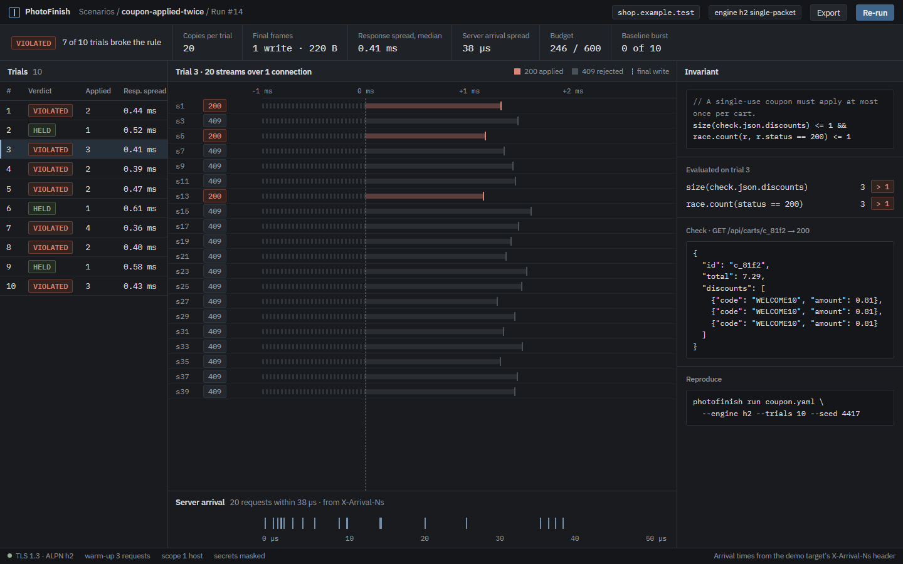

# PhotoFinish

**English** · [Русский](README.ru.md)

PhotoFinish proves race conditions in web APIs: synchronized requests via the HTTP/2 single-packet attack, a
business rule you declare, and the evidence.

Pre-alpha: milestone M0 - the demo target. The engines and scenarios arrive in M1-M2.

> **Note**: test only systems you own or are explicitly authorized to test. The demo shop in this repository is
> intentionally vulnerable and listens on loopback only. See [SECURITY.md](SECURITY.md).

## What exists now

`photofinish demo` starts a small shop over HTTPS with HTTP/2. Each scenario exists twice, with independent
in-memory SQLite state: `/vuln` checks in one statement and writes in another (a real check-then-act race), and
`/fixed` does the same thing atomically.

| Scenario | Endpoint | `/vuln` (racy) | `/fixed` (atomic) | Invariant |
|---|---|---|---|---|
| Coupon | `POST /api/carts/{id}/coupons` | count the code on the cart, then insert the discount | insert guarded by `UNIQUE(cart_id, code)` | at most one discount per code and cart |
| Transfer | `POST /api/transfers` | read the balance, then debit and credit | `UPDATE ... WHERE balance >= ?` in a transaction, affected rows checked | no balance below 0, total money constant |
| 2FA attempts | `POST /api/2fa/verify` | read the attempt counter, compare, then increment | `UPDATE ... WHERE attempts < 3`, affected rows checked | at most 3 codes compared |
| Gift card | `POST /api/giftcards/{code}/redeem` | read `redeemed`, credit the balance, then mark it | `UPDATE ... WHERE redeemed = 0` in a transaction, affected rows checked | a card's value is credited once |

Both variants share request parsing and responses; only the store operation differs. Every response carries
`X-Arrival-Ns`, the server's clock (Unix nanoseconds) at the moment it started handling the request, so the spread of
arrival times of a race can be measured on the server side. It is read from a high-resolution counter
(QueryPerformanceCounter on Windows, the monotonic clock elsewhere): the plain wall clock on Windows advances in
steps of tens of microseconds and would give a whole burst the same value. API responses also carry `X-PhotoFinish-Variant`.

Other routes, per variant: `GET /api/me`, `POST /api/carts`, `GET /api/carts/{id}`, `GET /api/2fa/status`, and
`POST /api/reset` (no token), which restores the seed state of that variant. `GET /` lists everything; `GET /healthz`
answers `{"status":"ok"}`.

Demo users: `alice` (token `demo-alice`) and `bob` (token `demo-bob`), 100.00 each (money is integer cents), coupon
`WELCOME10` (10 percent), gift cards `GIFT-ALICE-50` and `GIFT-BOB-50` (50.00 each), 2FA code `482913` with a limit of
3 attempts.

## Quick start

Requires Go 1.27+. No CGO, no other services.

```bash
git clone https://github.com/TroubieD3v/PhotoFinish.git
cd PhotoFinish
go run ./cmd/photofinish demo --window 200ms
```

The shop prints its URL (`https://127.0.0.1:8443`), the SHA-256 fingerprint of its fresh self-signed certificate
and the demo tokens. `--window` inserts an artificial pause between the check and the write in `/vuln` handlers so
that the race is easy to hit by hand; without it the race is still real, just narrower.

| Flag | Default | Meaning |
|---|---|---|
| `--addr` | `127.0.0.1:8443` | listen address; non-loopback addresses are refused without `--expose` |
| `--window` | `0s` | artificial pause in `/vuln` handlers, up to `2s` |
| `--expose` | off | allow a non-loopback address (isolated lab networks only) |
| `--quiet` | off | do not log requests |

In another terminal, apply the same coupon five times at once:

```bash
BASE=https://127.0.0.1:8443/vuln/api
AUTH='Authorization: Bearer demo-alice'
CART=$(curl -sk -X POST -H "$AUTH" "$BASE/carts" | sed -n 's/.*"id":"\([^"]*\)".*/\1/p')
for i in 1 2 3 4 5; do
  curl -sk -o /dev/null -w '%{http_code}\n' -X POST -H "$AUTH" -H 'Content-Type: application/json' \
    -d '{"code":"WELCOME10"}' "$BASE/carts/$CART/coupons" &
done; wait
curl -sk -H "$AUTH" "$BASE/carts/$CART"
```

On `/vuln` several requests answer `200` and the cart lists `WELCOME10` more than once, so `payable_cents` drops
below 7290. Set `BASE=https://127.0.0.1:8443/fixed/api` and repeat: exactly one `200`, the others `409`, one
discount. `curl -sk -X POST https://127.0.0.1:8443/vuln/api/reset` restores the seed state.

Five background `curl` processes are the naive approach: separate connections, no synchronization. Sending all
requests in one TCP packet is what the `h2` engine in M1 is for.

Build a binary instead: `make build` (or `go build -o bin/photofinish ./cmd/photofinish`), then
`./bin/photofinish demo`. `make test` runs `go vet` and the race-enabled tests.

## Roadmap

The design, in Russian: [docs/DESIGN.ru.md](docs/DESIGN.ru.md).

| Milestone | Delivers | Done when |
|---|---|---|
| **M0** | **repository, CI, the demo shop in two variants** | **`photofinish demo` starts, tests are green** |
| M1 | engines `h2` (single-packet), `h1` (last-byte sync), `burst`; the `probe` command | `h2` reliably catches the coupon race on `/vuln`; a benchmark shows the difference between engines |
| M2 | scenarios, CEL invariants, trials, verdicts, JSON evidence | `photofinish run examples/*.yaml` gives the right verdicts on `/vuln` and `/fixed` |
| M3 | SARIF, JUnit, HTML, Docker, GitHub Action | the Action fails a build against `/vuln` in a test repository |
| M4 | web UI (Scenarios, Editor, Run, Reports) | a scenario is built and run from the UI; the timeline shows the trials |
| M5 | EN/RU documentation, screenshots, GIF, release v0.1.0, article | the release is published, a race lab is in WebSec-Lab |

Planned UI, the Run screen (a mockup, not implemented yet):



## Responsible use

PhotoFinish is for systems you own or are authorized to test. Race testing sends bursts of synchronized requests
and can change real state: balances, orders, coupons, account lockouts. The demo shop is intentionally vulnerable:
it binds to `127.0.0.1` by default, refuses other addresses unless you pass `--expose`, keeps its state in memory
and uses throwaway tokens and a throwaway certificate.

[SECURITY.md](SECURITY.md) · [CONTRIBUTING.md](CONTRIBUTING.md) · [CHANGELOG.md](CHANGELOG.md)

## License

[MIT](LICENSE)
