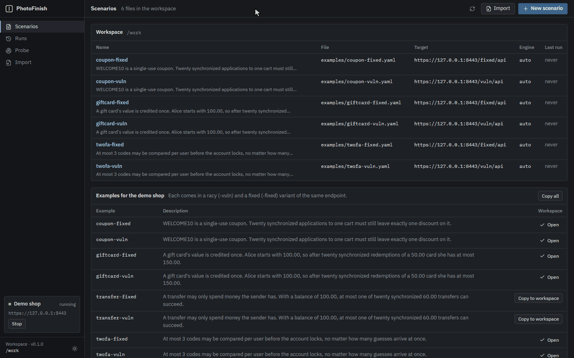
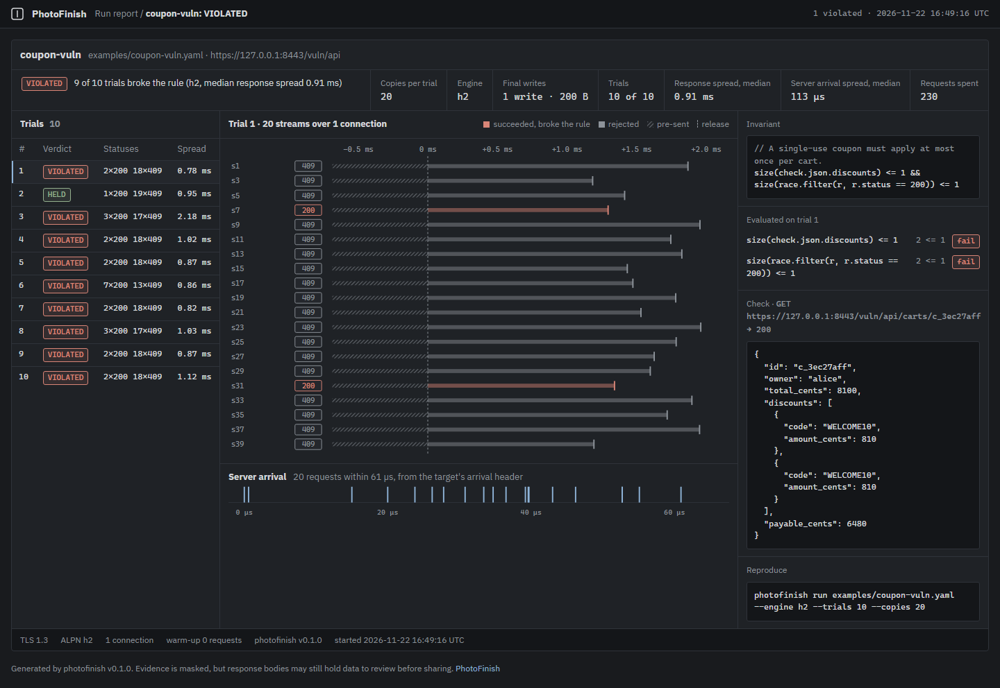
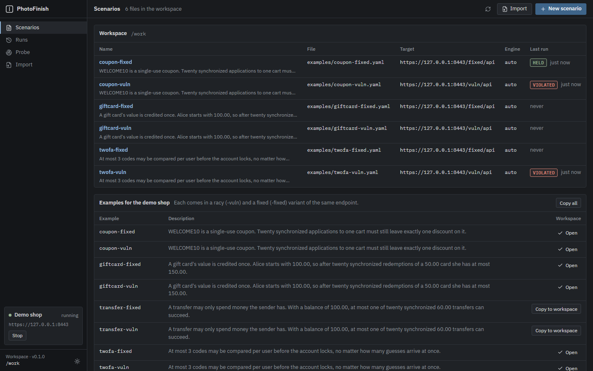
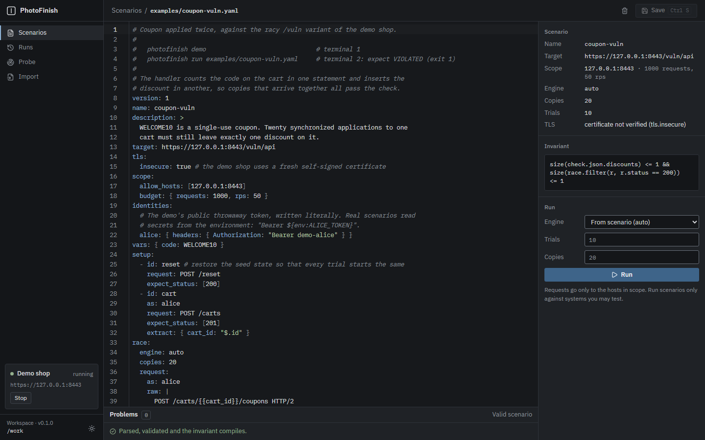
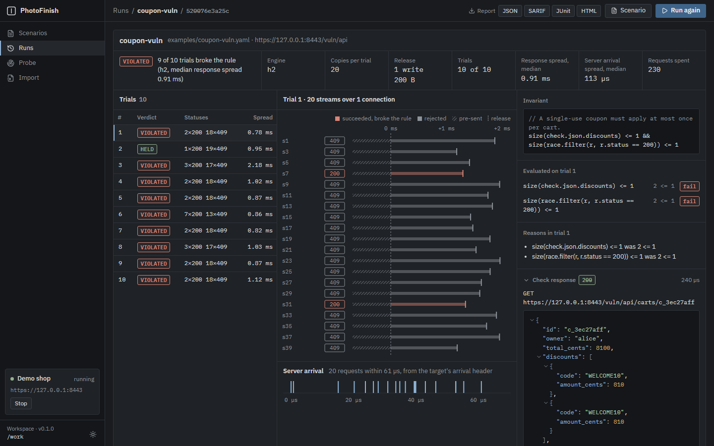

# PhotoFinish

[English](README.md) · **Русский**

PhotoFinish доказывает гонки (race conditions) в веб-API: синхронные запросы через HTTP/2 single-packet attack,
бизнес-правило, которое вы описываете сами, и доказательства.



Статус: v0.1.0, первый релиз. Проект ещё на ранней стадии: флаги командной строки, API `photofinish serve` и формат
сценариев до версии 1.0 могут измениться. Изменения перечислены в [CHANGELOG.md](CHANGELOG.md).

> **Важно**: тестируйте только свои системы или те, где тестирование явно разрешено. Демо-магазин в этом
> репозитории уязвим намеренно и слушает только loopback. См. [SECURITY.md](SECURITY.md).

## Что есть сейчас

| Команда | Что делает |
|---|---|
| `photofinish run <scenario.yaml>...` | прогоняет сценарии: подготовка, синхронная гонка, проверочный запрос и инвариант в каждой попытке; выводит вердикт и пишет доказательства в JSON, SARIF, JUnit и HTML |
| `photofinish probe <url>` | изучает цель (TLS, ALPN, настройки HTTP/2, время ответа, заголовок времени прихода) и советует движок |
| `photofinish import <file>` | делает заготовку сценария из сырого HTTP-запроса (Burp, DevTools) или записи HAR |
| `photofinish demo` | поднимает магазин по HTTPS с HTTP/2, четыре сценария которого есть в варианте с гонкой и в исправленном |
| `photofinish serve` | поднимает веб-интерфейс на `http://127.0.0.1:7340`: правка и проверка сценариев, запуск, попытки по мере готовности, таймлайн и вычисленный инвариант, история запусков, см. [Веб-интерфейс](#веб-интерфейс) |

Движки:

| Движок | Как отправляются запросы |
|---|---|
| `h2` | HTTP/2 single-packet attack: одно соединение; каждый запрос уходит без последнего байта (или без пустого финального кадра DATA), затем финальные кадры всех потоков уходят одной записью, одной TLS-записью (в одну запись помещается около 100 потоков; гонка побольше делится на несколько записей не длиннее 1200 байт, и отчёт об этом сообщает) |
| `h1` | HTTP/1.1 last-byte sync: по соединению на запрос, всё кроме последнего байта, затем последние байты подряд в одном цикле |
| `burst` | обычные параллельные запросы без синхронизации; базовая линия, с которой сравниваются два других |
| `auto` | `h2`, если сервер согласовал его через ALPN, иначе `h1` |

## Насколько хорошо это работает

[BENCHMARKS.md](BENCHMARKS.md) прогоняет каждый пример каждым движком против демо-магазина на раннере GitHub
Actions: 30 попыток по 20 копий, на чистом loopback и с добавленной задержкой 1 ms ± 0.5 ms и 5 ms ± 2 ms
(`tc netem`).

- При разбросе задержки 5 ms ± 2 ms медианный разброс прихода запросов гонки на сервер составил 0.08–0.21 ms у `h2`
  и 6.05–7.43 ms у `h1`.
- При 5 ms `h2` нарушил правило уязвимых вариантов в 7–29 попытках из 30, `h1` — в 0–4.
- Исправленные варианты получили HELD во всех 1080 попытках: ни одного ложного срабатывания.

Плотный приход необходим, но не достаточен: перемешаются ли запросы внутри окна гонки, зависит от сервера. При
разбросе 5 ms `burst` ловил гонку с купоном чаще, чем `h2` (14 против 7 из 30). Эти числа описывают демо-магазин на
одной машине; сравнивайте движки на своей цели.

## Установка

### Архивы релиза

На [странице Releases](https://github.com/TroubieD3v/PhotoFinish/releases) есть архив для каждой платформы:

| Платформа | Архив |
|---|---|
| Linux x86-64 | `photofinish_v0.1.0_linux_amd64.tar.gz` |
| Linux ARM64 | `photofinish_v0.1.0_linux_arm64.tar.gz` |
| macOS Intel | `photofinish_v0.1.0_darwin_amd64.tar.gz` |
| macOS Apple silicon | `photofinish_v0.1.0_darwin_arm64.tar.gz` |
| Windows x86-64 | `photofinish_v0.1.0_windows_amd64.zip` |

В каждом архиве каталог с тем же именем: один статический бинарник (`photofinish`, в Windows `photofinish.exe`) со
встроенным веб-интерфейсом, `README.md`, `README.ru.md` и `LICENSE`. В `checksums.txt` записан SHA-256 каждого
архива:

```bash
sha256sum --check --ignore-missing checksums.txt     # macOS: shasum -a 256 <архив>, сравните с checksums.txt
tar -xzf photofinish_v0.1.0_linux_amd64.tar.gz
./photofinish_v0.1.0_linux_amd64/photofinish version  # photofinish v0.1.0
```

Бинарники не подписаны. Если macOS не запускает бинарник, скачанный браузером, снимите атрибут карантина
с распакованного каталога: `xattr -dr com.apple.quarantine photofinish_v0.1.0_darwin_arm64` (на Intel —
`darwin_amd64`).

Примеров сценариев в архивах нет. Возьмите их из [examples/](examples/) или скопируйте в рабочий каталог с экрана
Scenarios веб-интерфейса.

### go install

```bash
go install github.com/TroubieD3v/photofinish/cmd/photofinish@latest
```

Нужен Go 1.27+; бинарник попадает в `$(go env GOPATH)/bin` (или в `GOBIN`), `photofinish version` показывает версию
модуля, например `v0.1.0`. Веб-интерфейса в таком бинарнике нет: интерфейс собирается в `internal/ui/dist/app` при
релизе, этого каталога нет в репозитории, поэтому нет его и в модуле, который скачивает `go install`. `run`, `probe`,
`import` и `demo` работают как обычно. `serve` запускается и API работает, но печатается заметка, что веб-интерфейс
не встроен в этот бинарник, а браузер получает страницу, где так и сказано. Для интерфейса возьмите архив релиза,
Docker-образ или соберите из исходников с `make ui`.

### Docker-образ

```bash
docker pull ghcr.io/troubied3v/photofinish:0.1.0
```

Образ собирается для linux/amd64 и linux/arm64. Релиз без суффикса получает теги `X.Y.Z`, `X.Y` и `latest` (здесь
`0.1.0`, `0.1` и `latest`), пре-релиз — только `X.Y.Z`. `latest` — релиз без суффикса, опубликованный последним.
Веб-интерфейс в образе есть. См. [Docker](#docker).

### Из исходников

Нужен Go 1.27+. Самой программе не нужны ни CGO, ни другие сервисы.

```bash
git clone https://github.com/TroubieD3v/PhotoFinish.git
cd PhotoFinish
make build            # или: go build -o bin/photofinish ./cmd/photofinish
```

`make test` запускает `go vet` и тесты с детектором гонок; детектору нужны CGO и компилятор C.

Веб-интерфейс собирается отдельным шагом, для него нужен Node.js 22: `make ui` (`npm --prefix web ci` и
`npm --prefix web run build`) пишет его в `internal/ui/dist/app`, и следующий `make build` встраивает его в бинарник.
Всё остальное работает и без него; бинарник, собранный без интерфейса, отвечает на `photofinish serve` страницей,
где так и сказано. В архивах релиза и в Docker-образе интерфейс есть всегда.

Команды ниже вызывают `./bin/photofinish` из сборки из исходников и файлы из `examples/`; с архивом релиза или
`go install` вызывайте свой `photofinish`.

## Запуск гонки

В одном терминале запустите демо-магазин:

```bash
./bin/photofinish demo
```

В другом прогоните сценарий с купоном против варианта с гонкой.
[examples/coupon-vuln.yaml](examples/coupon-vuln.yaml) сбрасывает магазин, создаёт корзину, применяет одноразовый
купон `WELCOME10` двадцать раз одним пакетом и проверяет, что скидка в корзине одна:

```bash
./bin/photofinish run examples/coupon-vuln.yaml --out reports
```

```text
run examples/coupon-vuln.yaml
trial 1/10: HELD (1 of 20 succeeded) spread 1.05ms
trial 2/10: VIOLATED (3 of 20 succeeded) spread 0.77ms
trial 3/10: HELD (1 of 20 succeeded) spread 1.03ms
trial 4/10: VIOLATED (4 of 20 succeeded) spread 0.83ms
trial 5/10: VIOLATED (2 of 20 succeeded) spread 0.78ms
trial 6/10: VIOLATED (4 of 20 succeeded) spread 0.98ms
trial 7/10: VIOLATED (5 of 20 succeeded) spread 0.87ms
trial 8/10: HELD (1 of 20 succeeded) spread 1.11ms
trial 9/10: VIOLATED (4 of 20 succeeded) spread 0.81ms
trial 10/10: VIOLATED (4 of 20 succeeded) spread 0.71ms
coupon-vuln: VIOLATED
  7 of 10 trials broke the rule (h2, median response spread 0.85 ms)
  rule       A single-use coupon must apply at most once per cart.
  invariant  size(check.json.discounts) <= 1 && size(race.filter(r, r.status == 200)) <= 1
  target     https://127.0.0.1:8443/vuln/api (engine h2, 20 copies)
  trials     10 run: 7 violated, 3 held
  timing     median response spread 0.85 ms, server arrival spread 0.35 ms
  failing terms in trial 2:
    FAIL  size(check.json.discounts) <= 1    (3 <= 1)
    FAIL  size(race.filter(r, r.status == 200)) <= 1    (3 <= 1)
  reproduce  photofinish run examples/coupon-vuln.yaml --engine h2 --trials 10 --copies 20
  report     reports/coupon-vuln.json

reports    reports/report.html, reports/results.sarif, reports/junit.xml
```

Код выхода 1 (VIOLATED). В `reports/coupon-vuln.json` лежат доказательства по каждой попытке: ответы подготовки и
проверки, каждый ответ гонки с отметками времени (предварительная отправка, финальный кадр, первый байт ответа и
время прихода на сервер из `X-Arrival-Ns`), значение каждой части инварианта и команда для воспроизведения.
Секреты маскируются. `report.html`, `results.sarif` и `junit.xml` охватывают все сценарии прогона, см. [Отчёты](#отчёты).

Та же гонка против атомарного варианта даёт вердикт HELD (код выхода 0):

```bash
./bin/photofinish run examples/coupon-fixed.yaml
```

HELD означает «не воспроизведено за N попыток» с измеренным разбросом, а не «безопасно». В `examples/` есть оба
варианта всех четырёх сценариев демо-магазина; `./bin/photofinish run examples/*.yaml` прогоняет все.

| Флаг | Что делает |
|---|---|
| `--engine auto\|h2\|h1\|burst` | заменяет `race.engine` |
| `--trials N`, `--copies N` | заменяют `trials` и `race.copies` |
| `--insecure` | не проверять TLS-сертификат (как `tls.insecure`) |
| `--format text\|json\|sarif\|junit\|html` | `text` (по умолчанию): ход прогона и сводка в stdout. Любой другой формат пишет один документ по всем сценариям в stdout (или в `--output`), а ход прогона уходит в stderr; `json` — один объект для одного файла, массив отчётов (в порядке файлов) для нескольких. См. [Отчёты](#отчёты) |
| `--output FILE` | записать документ `json`, `sarif`, `junit` или `html` в `FILE` вместо stdout |
| `--out DIR` | записать `DIR/<имя-сценария>.json` (полный отчёт) для каждого сценария и `DIR/report.html`, `DIR/results.sarif` и `DIR/junit.xml` для всех вместе, при любом `--format` |
| `--fail-on violated\|inconclusive\|never` | какие вердикты роняют прогон, см. коды выхода ниже (по умолчанию `violated`) |
| `--quiet` | без строк о ходе прогона, только сводка |

### Коды выхода

| Код | `run` | другие команды |
|---|---|---|
| 0 | все сценарии HELD | успех |
| 1 | хотя бы один сценарий VIOLATED | ошибка выполнения (`probe`, `import`, `demo`, `serve`) |
| 2 | INCONCLUSIVE: в каком-то сценарии не меньше половины попыток не удалось оценить | - |
| 3 | ERROR: ошибка в сценарии, запрет scope или сбой подготовки до первой гонки | - |
| 64 | ошибка использования (неизвестная команда, неверный флаг или аргумент) | ошибка использования |

Для нескольких сценариев `run` возвращает самый серьёзный код: 3, затем 1, затем 2, затем 0.

`--fail-on` меняет только коды вердиктов: `violated` (по умолчанию) и `inconclusive` дают коды из таблицы, то есть
сценарий INCONCLUSIVE и по умолчанию завершается с кодом 2; `never` даёт 0 при любых вердиктах, кроме ERROR (3), —
для конвейеров, которые только собирают отчёты. Отчёт, который не удалось записать, считается ERROR — и в коде
выхода, и в документах SARIF, JUnit и HTML этого прогона; так же считаются сценарии, до которых прогон не дошёл из-за
прерывания (Ctrl+C).

Попытка, в которой инвариант оказался ложным на чистой гонке, получает VIOLATED. INCONCLUSIVE она получает, если
инвариант не удалось вычислить, шаг подготовки ответил неожиданным кодом или гонка прошла неполноценно, что бы ни
говорил инвариант: запрос гонки завершился ошибкой или остался без ответа, ответ пришёл до финального кадра (эндпоинт
может быть статикой, или запрос не удержался), гонка упёрлась в ограничение скорости. Невыполненные части инварианта
такой попытки попадают в отчёт как заметки. Любой ответ 429 в гонке считается ограничением скорости, если сценарий не
задал `race.expect_429: true` и тем самым не объявил 429 ответом самого приложения (например, блокировкой 2FA); но и
тогда 429 с `Retry-After` или заголовком `RateLimit`, как и гонка, в которой 429 вернули все запросы, считается
ограничением скорости. Сценарий получает VIOLATED, если так закончилась хотя бы одна попытка.

## Отчёты

Один прогон, четыре формата. `--format` выбирает документ для stdout (или для `--output FILE`); `--out DIR` пишет
все сразу:

```bash
./bin/photofinish run examples/*-vuln.yaml --out reports
# reports/<scenario>.json, по одному на сценарий, и общие для всех
# reports/results.sarif, reports/junit.xml и reports/report.html
```

| Формат | Для чего | Что внутри |
|---|---|---|
| `json` | архив доказательств, свои инструменты | полный отчёт: каждая попытка, каждый ответ гонки с отметками времени, ответы подготовки и проверки, значение каждой части инварианта, команда воспроизведения |
| `sarif` | GitHub code scanning и другие просмотрщики SARIF | SARIF 2.1.0: по результату на каждый сценарий VIOLATED или INCONCLUSIVE, с привязкой к строке `check.invariant` в файле сценария |
| `junit` | вкладки с тестами в CI (GitHub, GitLab, Jenkins) | по набору тестов на сценарий, по тесту на попытку |
| `html` | отчёт для баг-баунти или пентеста, быстрый просмотр | одна самодостаточная страница: вердикт, попытки, таймлайн гонки, инвариант с вычисленными частями, ответ проверки и команда воспроизведения |

Правила SARIF:

| Правило | Имя | Уровень | Когда |
|---|---|---|---|
| `PF001` | InvariantViolatedUnderConcurrency | `error` | инвариант нарушен хотя бы в одной попытке: гонка доказана. Теги `security` и `race-condition`, security severity 7.5 |
| `PF002` | RaceTestInconclusive | `warning` | прогон не смог ничего решить: ошибки или ранние ответы, ограничение скорости, неожиданный код в подготовке |

В сообщении — итоговая фраза и невыполненные части инварианта первой попытки с нарушением, например
`size(check.json.discounts) <= 1 was 3 <= 1`. Пути к сценариям записываются относительно текущего каталога
(`%SRCROOT%`), поэтому запускайте из корня репозитория, чтобы code scanning связал результат с файлом сценария.
Сценарии HELD результатов не дают; сценарий ERROR становится уведомлением о выполнении инструмента, а запуск
помечается как неуспешный. У каждого результата есть отпечаток `photofinish/v1` от имени сценария, пути цели и
инварианта, поэтому от прогона к прогону, от хоста к хосту (staging или review-стенд) и при сдвиге строк это одно и
то же оповещение. Идентичность задаёт имя сценария: прогон, который пишет SARIF, JUnit или `--out DIR`, отказывается
запускать два сценария с одинаковым именем (код выхода 64) ещё до первого запроса, поэтому копиям сценария для разных
окружений нужны разные имена.

Соответствие JUnit:

| Отчёт | JUnit |
|---|---|
| прогон | `<testsuites name="photofinish">` |
| сценарий | `<testsuite name="<scenario>">` |
| попытка | `<testcase classname="photofinish.<scenario>" name="trial N">` |
| попытка VIOLATED | `<failure type="InvariantViolated">` с невыполненными частями инварианта и кодами ответов |
| попытка INCONCLUSIVE | `<skipped>` с причинами |
| попытка HELD | пройденный тест |
| сценарий ERROR | один тест `scenario` с `<error>` |

HTML-отчёт — один файл, который ничего не загружает из сети (встроенные CSS и SVG, установленные в системе
шрифты), в графитовой палитре со светлым вариантом для `prefers-color-scheme: light`. Для каждого сценария в нём
есть полоса статуса (вердикт, итоговая фраза, копии, движок, финальные записи, медианный разброс ответов и прихода на
сервер, потраченные запросы), таблица попыток, таймлайн первой попытки с нарушением (по строке на запрос:
предварительная отправка, финальный кадр, первый байт ответа; время прихода на сервер, если цель его сообщает),
инвариант с отметкой «выполнено» или «нарушено» по каждой части, ответ проверки и команда воспроизведения.



Все форматы строятся из одного отчёта, поэтому секреты маскируются во всех, но тела ответов в них есть. Просмотрите
отчёт, прежде чем им делиться, см. [SECURITY.md](SECURITY.md).

## Веб-интерфейс

```bash
make ui && make build
./bin/photofinish serve --demo
```

```text
PhotoFinish UI: http://127.0.0.1:7340/#token=<token>
```

Откройте напечатанную ссылку. `serve` работает с файлами сценариев рабочего каталога (по умолчанию текущего) и
хранит историю запусков; `--demo` заодно поднимает демо-магазин на `https://127.0.0.1:8443` (см. `--demo-addr`), так
что примеры можно сразу скопировать в рабочий каталог и запустить. `make ui` нужен только при сборке из исходников:
в бинарниках из архивов релиза и в Docker-образе интерфейс есть, в бинарнике из `go install` его нет (см.
[Установка](#установка)).

| Экран | Что делает |
|---|---|
| Scenarios | файлы сценариев рабочего каталога (`*.yaml`, `*.yml`) с целью, движком, последним вердиктом и временем последнего запуска; файлы с ошибками помечены, ошибка показана. Раздел «Examples for the demo shop» копирует встроенный пример в `examples/<name>.yaml` рабочего каталога |
| Editor | YAML с номерами строк и проверкой на лету: ошибки разбора, проверки и компиляции CEL-инварианта отмечены на своей строке и собраны в список проблем. Рядом: разобранная сводка (цель, scope, движок, копии, попытки, инвариант), параметры запуска (движок, попытки, копии и `insecure`, если сценарий сам не задаёт `tls.insecure`) и кнопка Run. Ctrl+S (Cmd+S) сохраняет; при уходе с несохранёнными правками интерфейс переспрашивает; New scenario начинается с шаблона с комментариями |
| Run | пока идёт гонка — полоса прогресса и попытки по мере завершения, кнопка Cancel. После: вердикт и итог, движок, копии, финальные записи и байты, медианный разброс ответов и прихода на сервер, потраченные запросы; таблица попыток; таймлайн выбранной попытки (строка на запрос гонки со статусом: предварительная отправка, release, первый байт ответа, точные значения при наведении или фокусе, время прихода на сервер в мкс); инвариант с каждым вычисленным термом и его значениями; проверочный ответ; шаги setup и reset; команда для воспроизведения; выгрузка в JSON, SARIF, JUnit и HTML |
| Runs | история запусков с фильтрами по сценарию и вердикту; завершённые запуски можно удалять |
| Probe | проверки `photofinish probe`: TLS, ALPN, HTTP/2 и его SETTINGS, статусы, время ответа, заголовок прихода и рекомендуемый движок |
| Import | вставьте или перетащите сырой запрос или файл HAR (и выберите запись HAR), посмотрите получившийся YAML со списком того, что ещё нужно заполнить, и сохраните его в рабочий каталог — он откроется в редакторе |

На боковой панели — запуск и остановка демо-магазина и путь рабочего каталога. У интерфейса тёмная графитовая тема и
светлая (по `prefers-color-scheme` или переключателю), им можно пользоваться с клавиатуры.







Остальные экраны: [Runs](docs/screenshots/runs.png), [Probe](docs/screenshots/probe.png),
[Import](docs/screenshots/import.png) и [Run в светлой теме](docs/screenshots/run-light.png).

| Флаг | По умолчанию | Значение |
|---|---|---|
| `--addr` | `127.0.0.1:7340` | адрес; адрес не на loopback без `--expose` — ошибка использования (64) |
| `--workspace` | `.` | каталог, файлы сценариев которого интерфейс показывает, читает и пишет |
| `--data` | `<каталог настроек пользователя>/photofinish` | история запусков, `photofinish.db` (SQLite); `--data ""` или `--data :memory:` держит её в памяти |
| `--demo` | выкл. | поднять демо-магазин на `--demo-addr` при старте; с боковой панели его тоже можно запустить и остановить |
| `--demo-addr` | `127.0.0.1:8443` | адрес демо-магазина, только loopback; примеры рассчитаны на адрес по умолчанию |
| `--demo-window` | `0s` | искусственная пауза между проверкой и записью в обработчиках `/vuln` демо-магазина, до `2s` (как `demo --window`) |
| `--expose` | выкл. | разрешить адрес не на loopback, с предупреждением (только для изолированных лабораторных сетей) |
| `--open` | выкл. | открыть интерфейс в браузере по умолчанию через закрытую страницу-переадресацию, чтобы токена не было в командной строке |

Одновременно идёт только одна гонка; запуск можно отменить. Каждый запуск сохраняется вместе с замаскированным
отчётом, в том числе закончившийся ERROR. Каталог настроек пользователя — `~/.config` в Linux,
`~/Library/Application Support` в macOS и `%AppData%` в Windows.

### Модель безопасности

`serve` по запросу отправляет атакующий трафик, поэтому открытая в браузере страница не должна иметь возможности им
управлять:

- **Только loopback.** По умолчанию сервер слушает `127.0.0.1`; любому другому адресу нужен `--expose`, и сервер
  печатает предупреждение.
- **Токен сессии.** 32 случайных байта (hex) на каждый запуск или `PHOTOFINISH_TOKEN` из окружения (не короче 32
  символов). Он печатается один раз во фрагменте ссылки (`#token=`), который браузер серверу не отправляет.
  Интерфейс кладёт его в `sessionStorage` вкладки и убирает из адресной строки. Каждому запросу к `/api/` нужен
  `Authorization: Bearer <token>` (сравнение за постоянное время), без него ответ 401; открыт только
  `GET /api/health`. Cookies нет, поэтому чужой сайт не может заставить браузер отправить токен.
- **Проверки Host и Origin.** Запрос, у которого `Host` не `127.0.0.1:<port>`, `localhost:<port>` или
  `[::1]:<port>`, отклоняется — это защита от DNS rebinding (с `--expose` подходит любой хост, API по-прежнему
  защищает токен). Запись (POST, PUT, DELETE) с `Origin`, который не совпадает с хостом, отклоняется с 403.
- **Заголовки.** Строгая Content Security Policy (`default-src 'self'`, `frame-ancestors 'none'`, без встроенных
  скриптов), `X-Content-Type-Options: nosniff`, `Referrer-Policy: no-referrer` и `Cache-Control: no-store` для API.
- **Только рабочий каталог.** Только файлы `*.yaml` и `*.yml`, относительные пути с прямыми слешами, без `..`, без
  абсолютных путей и без символических ссылок, ведущих за пределы каталога; файлы до 256 КиБ, тела запросов до
  1 МиБ. Имена нужно писать так, как они записаны на диске: другой регистр и короткие имена Windows 8.3
  отклоняются. Список строится на 4 уровня вглубь, до 500 файлов, без каталогов с точкой в начале, `node_modules`
  и `vendor`.
- **`--open`.** Браузер получает ссылку через страницу-переадресацию в закрытом временном каталоге, поэтому токена
  нет в командной строке запускающей программы и браузера, где его могли бы прочитать другие локальные
  пользователи.
- **Те же правила, что у CLI.** Запуск из интерфейса — обычный запуск: scope (`allow_hosts`) и бюджет сценария
  соблюдает runner, а сервер не добавляет способов их обойти.

Владелец токена может всё, что можно сделать в интерфейсе, в том числе записать сценарий с любым scope, поэтому
обращайтесь с токеном как с паролем. Модель угроз — в [SECURITY.md](SECURITY.md).

### Веб-интерфейс в Docker

В контейнере сервер должен слушать все интерфейсы контейнера, для этого нужен `--expose`; публикуйте его только на
loopback хоста и задайте токен сами, чтобы знать ссылку:

```bash
export PHOTOFINISH_TOKEN="$(openssl rand -hex 32)"
docker run --rm -p 127.0.0.1:7340:7340 -e PHOTOFINISH_TOKEN -v "$PWD:/work" ghcr.io/troubied3v/photofinish serve --addr 0.0.0.0:7340 --expose --workspace /work --data /tmp/pf
# затем откройте http://127.0.0.1:7340/#token=$PHOTOFINISH_TOKEN
```

`/tmp/pf` находится внутри контейнера, и история исчезает вместе с ним. Чтобы сохранять сценарии в смонтированный
каталог, добавьте `--user "$(id -u):$(id -g)"`, как для отчётов.

## Запуск в CI

Репозиторий — это GitHub Action. Он ставит PhotoFinish через Go, один раз прогоняет сценарии, пишет отчёты SARIF,
JUnit и HTML, добавляет в сводку задания таблицу (сценарий, вердикт, итог) и роняет шаг по правилу `fail-on`.
Направляйте его на тестовое окружение или staging, никогда на production.

```yaml
name: Race tests
on:
  workflow_dispatch:
  schedule:
    - cron: "0 3 * * *"

permissions:
  contents: read
  security-events: write # только для загрузки SARIF ниже

jobs:
  races:
    runs-on: ubuntu-latest
    steps:
      - uses: actions/checkout@v7
      - id: photofinish
        uses: TroubieD3v/PhotoFinish@v0
        env:
          ALICE_TOKEN: ${{ secrets.STAGING_ALICE_TOKEN }} # сценарий читает его как ${env:ALICE_TOKEN}
        with:
          scenarios: races/**/*.yaml
      # Необязательно: оповещения в code scanning (вкладка Security) по сценариям VIOLATED и INCONCLUSIVE.
      - uses: github/codeql-action/upload-sarif@v4
        if: always() && hashFiles('photofinish.sarif') != ''
        with:
          sarif_file: photofinish.sarif
          category: photofinish
      - uses: actions/upload-artifact@v7
        if: always()
        with:
          name: photofinish-report
          path: |
            photofinish-report.html
            photofinish-junit.xml
```

Тег `v0` указывает на новейший релиз v0.x.y; его переносит workflow релиза. Чтобы закрепить версию, укажите
`@v0.1.0` или SHA коммита. Action ставит PhotoFinish через `go install` с тем ref, с которым подключён сам, если вход
`version` не называет другой: `@v0` ставит новейший релиз v0.x.y, `@v0.1.0` — этот релиз. Установленный бинарник
показывает версию модуля (`v0.1.0`), и веб-интерфейса в нём нет; action он и не нужен. Право
`security-events: write` и шаг `upload-sarif` нужны, только если вам нужны оповещения; в приватном репозитории
`upload-sarif` нужно ещё `actions: read`.

| Вход | По умолчанию | Что делает |
|---|---|---|
| `scenarios` | (обязателен) | файлы сценариев через пробел или с новой строки; шаблоны раскрываются bash с `globstar` (`races/**/*.yaml`); шаблон без совпадений роняет шаг |
| `engine`, `trials`, `copies` | `""` | заменяют значения сценария (`--engine`, `--trials`, `--copies`) |
| `insecure` | `false` | `true` отключает проверку TLS-сертификата |
| `fail-on` | `violated` | передаётся в `--fail-on`: `violated` и `inconclusive` роняют шаг на VIOLATED и INCONCLUSIVE, `never` только на ERROR |
| `sarif` | `photofinish.sarif` | куда записать отчёт SARIF; `""` — не записывать |
| `junit` | `photofinish-junit.xml` | куда записать отчёт JUnit; `""` — не записывать |
| `html` | `photofinish-report.html` | куда записать HTML-отчёт; `""` — не записывать |
| `version` | `""` | версия PhotoFinish для `go install` (тег, ветка или коммит); пусто — ref, с которым подключён сам action |

| Выход | Что содержит |
|---|---|
| `verdict` | самый серьёзный вердикт: `HELD`, `INCONCLUSIVE`, `VIOLATED` или `ERROR` |
| `exit-code` | код выхода `photofinish run` с учётом `fail-on`; с ним же завершается action |
| `report-dir` | каталог `--out` (внутри `RUNNER_TEMP`, свой для каждого вызова action в задании) с JSON-отчётом каждого сценария |

Секреты приходят из `env:` шага, сценарий читает их через `${env:NAME}`; action их не выводит, а отчёты маскируют.
Action ставит Go 1.27 через `actions/setup-go`, и эта версия действует и в следующих шагах задания. Из checkout
этого репозитория (`uses: ./`) action собирает сам checkout, а не ставит релиз. Чтобы только собирать отчёты без
падения, задайте `fail-on: never` и читайте `steps.<id>.outputs.verdict`; чтобы продолжить после падения, используйте
`continue-on-error: true`.

В других CI запускайте бинарник или Docker-образ напрямую: `photofinish run races/*.yaml --out reports` завершается
с ненулевым кодом при VIOLATED и оставляет `reports/junit.xml` для вкладки с тестами.

## Docker

Образ `ghcr.io/troubied3v/photofinish` (linux/amd64 и linux/arm64, теги `0.1.0`, `0.1` и `latest`) собран на
distroless и работает не от root; точка входа — `photofinish`, рабочий каталог — `/work`. Команды ниже используют
`latest`; чтобы закрепить версию, добавьте `:0.1.0`:

```bash
docker run --rm -v "$PWD:/work" ghcr.io/troubied3v/photofinish run scenario.yaml
docker run --rm -e ALICE_TOKEN -v "$PWD:/work" ghcr.io/troubied3v/photofinish run scenario.yaml
docker run --rm --user "$(id -u):$(id -g)" -v "$PWD:/work" ghcr.io/troubied3v/photofinish run scenario.yaml --out reports
```

Вторая строка передаёт секрет из вашего окружения; третья запускает контейнер от вашего пользователя, чтобы он мог
записать отчёты в смонтированный каталог. Собрать образ самому:
`docker build -t photofinish --build-arg VERSION=dev .`

В контейнере демо-магазин должен слушать все интерфейсы контейнера, для этого нужен `--expose`; публикуйте его только
на loopback хоста:

```bash
docker run --rm -p 127.0.0.1:8443:8443 ghcr.io/troubied3v/photofinish demo --addr 0.0.0.0:8443 --expose
```

Веб-интерфейс в контейнере: см. [Веб-интерфейс в Docker](#веб-интерфейс-в-docker).

Внутри другого контейнера `127.0.0.1` — это сам контейнер. В Linux запускайте сценарии с `--network host`, чтобы
достучаться до магазина на loopback хоста:

```bash
docker run --rm --network host -v "$PWD/examples:/work/examples:ro" ghcr.io/troubied3v/photofinish run examples/coupon-fixed.yaml
```

## Формат сценария

Краткая справка; полные файлы лежат в [examples/](examples/).

```yaml
version: 1
name: coupon-applied-twice                # [a-z0-9-]+, имя файла отчёта
target: https://shop.example.test/api     # пути запросов добавляются к его пути
tls: { insecure: false }                  # true отключает проверку сертификата
scope:
  allow_hosts: [shop.example.test]        # обязательно; каждый запрос проверяется до отправки
  budget: { requests: 600, rps: 50 }      # общий лимит на прогон; скорость шагов setup/check/reset
identities:
  alice: { headers: { Authorization: "Bearer ${env:ALICE_TOKEN}" } }
vars: { code: WELCOME10 }
setup:                                    # перед каждой попыткой
  - id: cart
    as: alice
    request: POST /carts
    expect_status: [201]
    extract: { cart_id: "$.id" }          # "$.json.path", "header:Name" или "status"
race:
  engine: auto                            # h2 | h1 | burst | auto
  copies: 20                              # 1..1000
  request:
    as: alice
    raw: |
      POST /carts/{{cart_id}}/coupons HTTP/2
      Content-Type: application/json

      {"code":"{{code}}"}
check:
  as: alice
  request: GET /carts/{{cart_id}}
  invariant: >
    size(check.json.discounts) <= 1 &&
    size(race.filter(r, r.status == 200)) <= 1
  explain: A single-use coupon must apply at most once per cart.
reset: []                                 # необязательные шаги после каждой попытки
trials: 10
```

| Ключ | Что значит |
|---|---|
| `target` | базовый URL; `/carts` под `https://host/api` становится `https://host/api/carts` |
| `scope.allow_hosts` | хосты сравниваются с `host:port` без учёта регистра; хост без порта разрешает любой порт; всё остальное отклоняется до открытия соединения |
| `scope.budget` | `requests` ограничивает все запросы прогона, включая прогрев (по умолчанию 1000); когда лимит исчерпан, оставшиеся попытки пропускаются. `rps` ограничивает шаги setup, check и reset, но не гонку (по умолчанию 20) |
| `identities` | именованные наборы заголовков, шаг выбирает их через `as`; значения в отчётах маскируются |
| `vars`, `{{name}}` | переменные шаблонов; `extract` добавляет значения из ответов подготовки; неизвестное имя - ошибка. `{{"текст"}}` вставляет текст как есть: `{{"{{"}}` - это буквальное `{{`, `{{"${env:"}}` - буквальное `${env:` (так `import` экранирует захваченные запросы) |
| `${env:NAME}` | берётся из окружения и маскируется в отчётах; отсутствующая переменная - ошибка |
| `request` / `raw` | `METHOD /path` или сырой запрос целиком: строка запроса, заголовки, пустая строка, тело. Заголовок `Host` игнорируется, адрес задаёт target; `json:` задаёт JSON-тело |
| `race.request` / `race.requests` | один запрос, отправленный `copies` раз, или список запросов (multi-endpoint race) со своими `copies` |
| `race.warmup`, `race.gate` | запросы прогрева по тем же соединениям перед гонкой (по умолчанию 0); пауза между предварительной отправкой и финальным кадром (по умолчанию 100ms) |
| `race.expect_429` | `true` объявляет ответы 429 без `Retry-After` и заголовков `RateLimit` ответом приложения, а не ограничением скорости (по умолчанию false: любой 429 делает попытку INCONCLUSIVE) |
| `check.invariant` | выражение на [CEL](https://cel.dev), которое должно быть истинным после гонки |
| `evidence.arrival_header` | заголовок ответа со временем прихода запроса на сервер в наносекундах Unix (по умолчанию `X-Arrival-Ns`, `-` отключает) |

Инвариант видит `race` (ответы гонки по порядку), `check` (ответ проверки), `setup` (ответы подготовки по id шага) и
`vars`. У ответа есть `status`, `headers` (имена в нижнем регистре), `body`, `json` (разобранное тело или null), а
в `race` ещё `index` и `error`. Доступны стандартные макросы `filter`, `exists`, `all`, `map` и `size`. Каждая
часть верхнеуровневой цепочки `&&` вычисляется отдельно, поэтому отчёт показывает, какая часть не выполнилась и с
какими значениями, например `3 <= 1`.

## Probe и import

```bash
./bin/photofinish probe https://127.0.0.1:8443/vuln/api/me --insecure
./bin/photofinish import request.txt --output scenario.yaml    # сырой запрос из Burp или DevTools
./bin/photofinish import capture.har --har-entry 3             # одна запись HAR, YAML в stdout
```

`probe` отправляет три GET-запроса и никакого трафика гонки. `import` пишет заготовку, которая намеренно не
проходит проверку, пока вы не напишете check и инвариант; проверьте scope и бюджет и перенесите учётные данные в
`${env:NAME}`.

## Демо-магазин

`photofinish demo` поднимает небольшой магазин по HTTPS с HTTP/2. Каждый сценарий есть в двух вариантах с
независимым состоянием в SQLite в памяти: `/vuln` проверяет одним запросом к базе и пишет другим (настоящая гонка
check-then-act), `/fixed` делает то же самое атомарно.

| Сценарий | Эндпоинт | `/vuln` (с гонкой) | `/fixed` (атомарно) | Инвариант |
|---|---|---|---|---|
| Купон | `POST /api/carts/{id}/coupons` | считает код в корзине, затем вставляет скидку | вставка под защитой `UNIQUE(cart_id, code)` | не больше одной скидки на код и корзину |
| Перевод | `POST /api/transfers` | читает баланс, затем списывает и зачисляет | `UPDATE ... WHERE balance_cents >= ?` в транзакции с проверкой затронутых строк | баланс отправителя не уходит ниже 0 |
| Попытки 2FA | `POST /api/2fa/verify` | читает счётчик попыток, сравнивает код, затем увеличивает счётчик | `UPDATE ... WHERE attempts < 3` с проверкой затронутых строк | сравнивается не больше 3 кодов |
| Подарочная карта | `POST /api/giftcards/{code}/redeem` | читает `redeemed`, зачисляет баланс, затем помечает карту | `UPDATE ... WHERE redeemed = 0` в транзакции с проверкой затронутых строк | номинал карты зачисляется один раз |

Оба варианта разбирают запросы и формируют ответы одним кодом, различается только операция с хранилищем. Каждый ответ
несёт заголовок `X-Arrival-Ns`: время сервера (наносекунды Unix) в момент, когда запрос пришёл целиком, вместе с телом. По нему разброс
прихода запросов гонки можно измерить на стороне сервера. Время берётся из счётчика высокого
разрешения (QueryPerformanceCounter на Windows, монотонные часы на остальных системах): обычные системные часы на
Windows шагают по десяткам микросекунд, и весь залп получил бы одно и то же значение. Ответы API несут ещё `X-PhotoFinish-Variant`.

Остальные маршруты в каждом варианте: `GET /api/me`, `POST /api/carts`, `GET /api/carts/{id}`,
`GET /api/2fa/status` и `POST /api/reset` (без токена), который возвращает исходное состояние этого варианта.
`GET /` перечисляет всё, `GET /healthz` отвечает `{"status":"ok"}`.

Демо-пользователи: `alice` (токен `demo-alice`) и `bob` (токен `demo-bob`), по 100.00 на счёте (деньги в целых
центах), купон `WELCOME10` (10 процентов), подарочные карты `GIFT-ALICE-50` и `GIFT-BOB-50` (по 50.00), код 2FA
`482913` с лимитом 3 попытки. В примерах демо-токены записаны прямо в файл; настоящие сценарии берут секреты через
`${env:NAME}`.

| Флаг | По умолчанию | Что делает |
|---|---|---|
| `--addr` | `127.0.0.1:8443` | адрес для прослушивания; адреса вне loopback без `--expose` отклоняются |
| `--window` | `0s` | искусственная пауза между проверкой и записью в обработчиках `/vuln`, до `2s` |
| `--expose` | выключен | разрешить адрес вне loopback (только для изолированной лабораторной сети) |
| `--quiet` | выключен | не писать журнал запросов |

Без `--window` гонка настоящая, но окно узкое; движок `h2` рассчитан как раз на такие окна. Интеграционные тесты
прогоняют примеры с окном 2ms, чтобы результат не зависел от медленной машины CI.

## Этапы

Проектный документ: [docs/DESIGN.ru.md](docs/DESIGN.ru.md).

| Этап | Что готово | Критерий |
|---|---|---|
| **M0** | **репозиторий, CI, демо-магазин в двух вариантах** | **`photofinish demo` поднимается, тесты зелёные** |
| **M1** | **движки `h2` (single-packet), `h1` (last-byte sync), `burst`, команда `probe`** | **`h2` стабильно ловит купон на `/vuln`; [BENCHMARKS.md](BENCHMARKS.md) показывает разброс прихода у `h2` против `h1` и `burst` (workflow Benchmark)** |
| **M2** | **сценарии, CEL, trials, вердикты, JSON-доказательства** | **`photofinish run examples/*.yaml` даёт верные вердикты на `/vuln` и `/fixed`** |
| **M3** | **SARIF, JUnit, HTML, Docker, GitHub Action** | **Action роняет сборку на `/vuln` (задание `action` в CI)** |
| **M4** | **веб-интерфейс (Scenarios, Editor, Run, Runs, Probe, Import) и `photofinish serve`** | **сценарий собирается и запускается из UI, таймлайн показывает попытки (задание `web` в CI)** |
| **M5** | **документация EN/RU, скриншоты, GIF, релиз v0.1.0** | **релиз опубликован** |
| Позже | статья; лаборатория-гонка в WebSec-Lab | - |

Экран Run сделан по макету [docs/mockup-run.png](docs/mockup-run.png); скриншоты настоящего интерфейса лежат в
[docs/screenshots/](docs/screenshots/).

## Ответственное использование

PhotoFinish предназначен для своих систем и систем, где тестирование разрешено. Проверка гонок отправляет пачки
синхронных запросов и может менять реальное состояние: балансы, заказы, купоны, блокировки аккаунтов. Каждый
сценарий обязан перечислить хосты, к которым можно обращаться, а бюджет запросов ограничивает прогон. Демо-магазин
уязвим намеренно: по умолчанию он слушает `127.0.0.1`, без `--expose` отклоняет другие адреса, хранит состояние в
памяти, а токены и сертификат у него одноразовые. `photofinish serve` тоже слушает только loopback и отвечает
только на запросы с его токеном сессии.

[SECURITY.md](SECURITY.md) · [CONTRIBUTING.md](CONTRIBUTING.md) · [CHANGELOG.md](CHANGELOG.md)

## Лицензия

[MIT](LICENSE)
